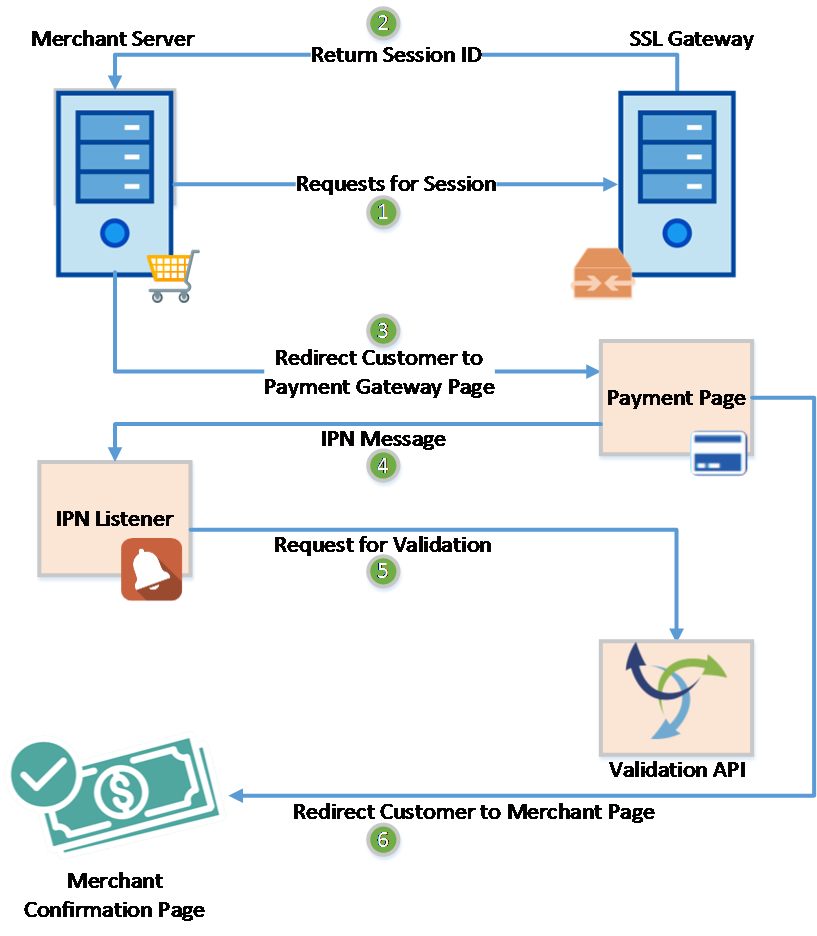

# SSLCommerz payments

Our second payment gateway, next to ShurjoPay (`lib/payment/shurjopay`).
It is **off** unless `SSLCOMMERZ_ENABLED="true"` and the store id and password are set
(see `config.ts`).

## The flow — SSLCommerz's official diagram



The code follows this diagram step by step, and the comments in the code use
the same numbers ①–⑥, so you can search for e.g. `⑤` to find that step.

| Step | What happens | Where in our code |
|---|---|---|
| **①** Requests for Session | Our server asks SSLCommerz to open a payment session | `api.ts` → `startPayment()` (called from `app/actions/payment-sslcommerz.ts`) |
| **②** Return Session ID | SSLCommerz answers with the session id (`sessionkey`) and the payment page URL (`GatewayPageURL`) | `api.ts` → `startPayment()` |
| **③** Redirect Customer to Payment Gateway Page | The browser goes to `GatewayPageURL`; the runner pays (bKash, Nagad, card…) | `module/checkout/pages/CheckoutPage.tsx` → `window.location.href = checkoutUrl` |
| **④** IPN Message | SSLCommerz's **server** posts the result to our IPN Listener | `app/api/payment/sslcommerz/ipn/route.ts` |
| **⑤** Request for Validation | We send the posted `val_id` to the **Validation API** and confirm the order if it's really paid | `confirm-payment.ts` → `askSslCommerz()` → `api.ts` → `validatePayment()` |
| **⑥** Redirect Customer to Merchant Page | SSLCommerz sends the **browser** back to us; we show our confirmation page | `app/api/payment/sslcommerz/success/`, `fail/`, `cancel/` → `route.ts` |

```
 Checkout button
   │
   ▼
 initiateSslCommerzPayment()                     app/actions/payment-sslcommerz.ts
   │  checks: switched on? order ok? not paid already? keep the slot
   │  tranId = newTranId()
   │  ① ② startPayment()  ──────────────►  SSLCommerz  (/gwprocess/v4/api.php)
   │      ◄── sessionkey + GatewayPageURL
   │  save tranId in Payment.paymentId
   ▼
 ③ browser → GatewayPageURL → runner pays on SSLCommerz
   │
   ├── ④ SSLCommerz server ──POST──► /api/payment/sslcommerz/ipn       (IPN Listener)
   │                                     │
   │                                     ▼
   │                          ⑤ confirmSslCommerzPayment()   confirm-payment.ts
   │                             validatePayment(val_id) ──► Validation API
   │                             all checks ok → order CONFIRMED → email + SMS
   │                                     ▲
   └── ⑥ browser ──POST──► /api/payment/sslcommerz/success  ─┘  (also runs ⑤ — safe twice)
                            /api/payment/sslcommerz/fail
                            /api/payment/sslcommerz/cancel
          then → /payment/success  or  /payment/failed  or  /payment/processing
```

## Where is the code? (quick map)

Search for the function name or the step marker (e.g. `①`) to jump straight there.

**Where does our server ask SSLCommerz for a session id?**
→ `lib/payment/sslcommerz/api.ts` → `startPayment()` — the comments `// ① Requests for Session`
(the `fetch` to `/gwprocess/v4/api.php`) and `// ② Return Session ID` (reads `sessionkey` +
`GatewayPageURL` from the reply).

| Step | File | Function / line to search for |
|---|---|---|
| Runner clicks Pay | `module/checkout/pages/CheckoutPage.tsx` | `initiateSslCommerzPayment(paymentArgs)` |
| Make our attempt id | `app/actions/payment-sslcommerz.ts` | `const tranId = newTranId();` |
| ① Requests for Session | `app/actions/payment-sslcommerz.ts` → `lib/payment/sslcommerz/api.ts` | `await startPayment({` → `// ① Requests for Session` |
| ② Return Session ID | `lib/payment/sslcommerz/api.ts` | `// ② Return Session ID` |
| Save the attempt | `app/actions/payment-sslcommerz.ts` | `prisma.payment.update(` (stores `tranId` in `Payment.paymentId`) |
| Log the session id | `app/actions/payment-sslcommerz.ts` | `"sslcommerz:session_started"` |
| ③ Redirect to payment page | `module/checkout/pages/CheckoutPage.tsx` | `window.location.href = paymentResult.checkoutUrl` |
| ④ IPN Message | `app/api/payment/sslcommerz/ipn/route.ts` | `readCallback(request)` → `confirmPayment(tranId, valId, log)` |
| ⑤ Request for Validation | `lib/payment/sslcommerz/confirm-payment.ts` | `askSslCommerz(tranId, valId)` |
| ⑤ Validation API call | `lib/payment/sslcommerz/api.ts` | `validatePayment()` (→ `validationserverAPI.php`) |
| ⑤ Fallback lookup | `lib/payment/sslcommerz/api.ts` | `getTransaction()` (→ `merchantTransIDvalidationAPI.php`) |
| ⑤ Confirm the order | `lib/payment/sslcommerz/confirm-payment.ts` | `confirmPaidOrder(` → `sendEmailAndSms()` |
| ⑥ Customer back to us | `app/api/payment/sslcommerz/success/route.ts` (and `fail/`, `cancel/`) | `readCallback(request)` → `confirmPayment(...)` → `redirectTo(...)` |

### Where does the session id (`sessionkey`) go?

It comes back from SSLCommerz in `startPayment()` (②) and is **only logged** — in
`payment-sslcommerz.ts` as `sslcommerz:session_started`. Everything after that finds
the order by **our `tran_id`**, which we create before the session even exists.

To find the session id of a payment (e.g. for SSLCommerz support):

```bash
pm2 logs nextjs-app --lines 500 --nostream | grep session_started
```

## Step by step, with the code

**Before ①: the runner clicks "Pay with SSLCommerz"** — `CheckoutPage.tsx`
`handlePlaceOrder()` calls the server action
`initiateSslCommerzPayment({ orderId, customerName, customerEmail, customerPhone })`.
It checks the settings and the order, makes sure nobody is charged twice, keeps the
runner's slot, and makes **our** id for this attempt:
```ts
const tranId = newTranId(); // e.g. "SSLMHSX2K1A9F3C2E1B" — new for every attempt
```

**① Requests for Session** — `api.ts` → `startPayment()`
```ts
const res = await fetch(`${apiUrl}/gwprocess/v4/api.php`, {
  method: "POST",
  body: form, // store_id, store_passwd, tran_id, total_amount, currency,
              // success_url, fail_url, cancel_url (⑥), ipn_url (④),
              // value_a (= our order id), product + customer details
});
```

**② Return Session ID** — SSLCommerz answers (real sandbox reply, shortened):
```json
{
  "status": "SUCCESS",
  "sessionkey": "7A1B9C…",
  "GatewayPageURL": "https://sandbox.sslcommerz.com/EasyCheckOut/testcde…"
}
```
`startPayment()` returns `GatewayPageURL` (+ `sessionkey`, which we only log) when
`status` is `"SUCCESS"`. Otherwise `failedreason` becomes the error and the action
writes an admin alert (`reportGatewayFailure()` → red banner in admin + audit log).

The action then saves the attempt, so every later step can find the order:
```ts
await prisma.payment.update({
  where: { id: order.payment.id },
  data: { paymentId: tranId, paymentGateway: "sslcommerz", paymentMethod: "sslcommerz" },
});
return { success: true, error: "", checkoutUrl: started.paymentPageUrl };
```

**③ Redirect Customer to Payment Gateway Page** — `CheckoutPage.tsx`
```ts
window.location.href = paymentResult.checkoutUrl; // the GatewayPageURL
```
The runner pays on SSLCommerz's page.

**④ IPN Message** — `app/api/payment/sslcommerz/ipn/route.ts`
SSLCommerz's server posts a form with `tran_id`, `val_id`, `status`, `amount`, …
We read **only** `tran_id` and `val_id` (`readCallback()` in `callback-helpers.ts`).

**⑤ Request for Validation** — `confirm-payment.ts` → `askSslCommerz()`
```ts
// 1st choice — the Validation API, as in the diagram:
validatePayment(valId);
// → GET {apiUrl}/validator/api/validationserverAPI.php?val_id=…&store_id=…&store_passwd=…&format=json
// Trusted only if it says VALID/VALIDATED for THIS tran_id.

// Otherwise (no val_id, or validation didn't confirm) — look it up by our tran_id:
getTransaction(tranId);
// → GET {apiUrl}/validator/api/merchantTransIDvalidationAPI.php?tran_id=…&store_id=…&store_passwd=…&format=json
```
If SSLCommerz says the payment is paid **and** `findProblem()` finds nothing wrong,
`confirmPaidOrder()` marks the payment PAID and the order CONFIRMED, and the
confirmation email/SMS is sent (`runPostPaymentSteps()`).

**⑥ Redirect Customer to Merchant Page** — `success/`, `fail/`, `cancel/` → `route.ts`
SSLCommerz posts the **browser** back to us (also with `tran_id` + `val_id`). Each
route runs ⑤ as well (does nothing new if the IPN already confirmed it — and catches
the payment if the IPN is late), then sends the runner to our page:

| Route | Ends on |
|---|---|
| `success/` | `/payment/success` (or `/payment/processing` if SSLCommerz hasn't settled yet) |
| `fail/` | `/payment/failed?reason=payment_failed` — slot freed if SSLCommerz confirms it failed |
| `cancel/` | `/payment/failed?reason=cancelled` — slot freed if SSLCommerz confirms it was cancelled |

### `tran_id`, `val_id` and `sessionkey` — which is which?

| Id | Who makes it | When | What we use it for |
|---|---|---|---|
| `tran_id` | **We do** (`newTranId()`) | before ①, new for every attempt | Saved in `Payment.paymentId`; finds the order in every step; the fallback lookup |
| `sessionkey` | SSLCommerz | ② | Only logged (useful for SSLCommerz support) |
| `val_id` | SSLCommerz | ④ / ⑥, only after a successful payment | Sent to the Validation API in ⑤ |

The reconciler, the hourly sweep and the "confirming your payment…" page never
receive a `val_id`, so they always use the `tran_id` lookup.

## The one rule: never trust what SSLCommerz posts to us

Anyone can send a fake "payment successful" POST to our callback URLs. So the
callbacks only read `tran_id` and `val_id` from the post, then **ask SSLCommerz
ourselves** (⑤), and only confirm when:

- SSLCommerz says the status is `VALID` or `VALIDATED` **for this `tran_id`**,
- the currency is BDT and the amount is at least the order total,
- the payment belongs to this order (`value_a` = our order id),
- SSLCommerz didn't flag it as risky.

Otherwise it goes to **admin → Payment issues** for a person to decide.

A fake or someone else's `val_id` can't confirm anything: the Validation API's
answer must name our `tran_id`, or we ignore it and look the payment up by
`tran_id` instead.

`confirmSslCommerzPayment` is safe to call many times for the same payment
(success page + IPN usually arrive together): only the first call confirms the
order and sends the email/SMS.

## IPN (Instant Payment Notification)

### the IPN URL for the merchant panel, https://www.merchcommunication.com/api/payment/sslcommerz/ipn

### What it is

After a payment, SSLCommerz tells us the result **two ways**:

|                                         | ⑥ Browser redirect (`success` / `fail` / `cancel`) | ④ IPN (`ipn`)                  |
| --------------------------------------- | -------------------------------------------------- | ------------------------------ |
| Who calls us                            | The customer's browser                             | SSLCommerz's server            |
| Arrives if the customer closes the tab? | ❌ No                                              | ✅ Yes                         |
| What we answer                          | A redirect to one of our pages                     | JSON `{ ok: true }` (HTTP 200) |

The IPN is the backup that still works when the customer closes the tab, loses
internet, or their phone dies right after paying. That's why we need it.

### How SSLCommerz sends it

SSLCommerz `POST`s an HTML form to our IPN URL, with fields like:

```
tran_id=SSLMHSX2K1A9F3C2E1B   ← used: finds the order
val_id=2411101234abcd         ← used: sent to the Validation API (⑤)
status=VALID  amount=100.00  currency=BDT  value_a=<order id>  ...   ← ignored
```

It goes to the `ipn_url` we send when starting each payment (`api.ts` →
`startPayment()`), which is `{NEXT_PUBLIC_SITE_URL}/api/payment/sslcommerz/ipn`.

### How we handle it — `app/api/payment/sslcommerz/ipn/route.ts`

This follows SSLCommerz's "Validate Payment with IPN" section
(https://developer.sslcommerz.com/doc/v4/) step by step:

| SSLCommerz's docs say | We do it in |
|---|---|
| 1. Grab the POST notification | `readCallback()` — reads `tran_id` + `val_id`; junk `tran_id` → 400 |
| 2. Make sure the post wasn't tampered with | We never trust the posted `status`/`amount`; step 3 asks SSLCommerz itself |
| 3. Call the Validation API with `val_id` | `confirmPayment()` → ⑤ `validatePayment()` (falls back to `getTransaction(tran_id)`) |
| 4. Check status `VALID`/`VALIDATED`, amount and currency against **your** database, and that the transaction exists | `confirm-payment.ts` → `findProblem()` (+ our order id and the risk flag) |
| 5. "Check for the status — VALID, FAILED, CANCEL — to update your order status" | Paid → order confirmed. Failed / cancelled / expired → `releaseSlotIfEnded()` frees the slot |
| 6. Reply (any message) | `{ ok: true }` with HTTP 200 |

```
④ readCallback()          read tran_id + val_id from the form; junk tran_id → 400
⑤ confirmPayment()        Validation API (val_id) → confirm the order if really paid
                          (same function as the success page — confirm-payment.ts)
   not paid?              releaseSlotIfEnded() → free the slot, but only if SSLCommerz
                          says the attempt FAILED / CANCELLED / EXPIRED
   return 200 { ok: true }
```

`VALIDATED` (from the Validation API) means "a successful transaction, but you've
already validated it before" — e.g. the success page asked first. We treat it as paid;
`confirmPaidOrder()` makes sure it's only confirmed once.

Things to know:

- **We ignore `status`, `amount` etc. in the posted form.** Anyone can POST a fake
  "VALID" to this URL. Step ⑤ asks SSLCommerz directly, so a fake IPN changes nothing.
- **IPN and the success redirect usually arrive at the same time.** Both call
  `confirmSslCommerzPayment()`; only the first one confirms and sends the email/SMS,
  the other gets `ALREADY_PAID`. Safe to receive either one, both, or repeats.
- **A failed / cancelled / expired IPN frees the runner's slot** — only when SSLCommerz
  itself says that attempt ended, and only for the order's **current** attempt (an old
  attempt's "cancelled" never touches a newer one the runner is paying now). Whether
  it's recorded as `payment.cancelled` or `payment.declined` comes from SSLCommerz's
  answer. The `fail` / `cancel` redirects do the same; if both arrive, the slot is
  freed once. Anything else unpaid is left to the hourly sweep.
- **A paid-but-wrong payment never frees a slot.** Short amount, wrong order or
  risky → it's held for an admin (Payment issues), slot kept.
- **Answer 200 quickly.** The email/SMS runs after the response (Next's `after()`),
  so SSLCommerz isn't kept waiting.
- **`verify_sign` / `verify_key` (hash) are not used.** The docs don't explain how to
  compute them, and SSLCommerz's own PHP library defines a hash check
  (`SSLCOMMERZ_hash_verify`) but never calls it — it relies on the Validation API,
  like we do. Asking SSLCommerz server-to-server is stronger than any hash.

### Setting it up (live)

1. In the **SSLCommerz merchant panel**, set the IPN URL to
   `https://www.merchcommunication.com/api/payment/sslcommerz/ipn`
   (we also send it with every payment, but set it in the panel too).
2. `NEXT_PUBLIC_SITE_URL` on the server must be the public **https** domain —
   SSLCommerz can't reach `localhost`. The code refuses to start a live payment
   otherwise (`config.ts` → `getSiteUrl()`).
3. Nothing in front of the app (nginx, firewall, Cloudflare) may block `POST`s
   from SSLCommerz to `/api/payment/sslcommerz/ipn`. SSLCommerz's docs: the listener
   "must use the common port like 80 or 443", "must be reachable from Internet", and
   you should "white-list the SSLCOMMERZ IPs at your network firewall" (the IP list is
   in their docs — check it there, it can change).

### Is it working?

- **Logs:** each IPN logs `sslcommerz:ipn` → `payment:checked` with the `result`
  (`CONFIRMED`, `ALREADY_PAID`, `NOT_PAID`, …). `pm2 logs nextjs-app | grep sslcommerz:ipn`
- **Audit log** (admin): a confirmed payment shows "Payment SSL… confirmed via SSLCommerz".
- **Test by hand** (safe — a fake tran_id just answers "not found"):
  ```bash
  curl -i -X POST https://www.merchcommunication.com/api/payment/sslcommerz/ipn \
       -d "tran_id=SSLTEST00000000"
  # expect: HTTP 200  {"ok":true}
  ```

### Testing locally

SSLCommerz's server can't reach your laptop, so **IPNs don't arrive locally** —
that's fine: the success redirect (your browser) confirms the payment, and the
5-minute reconciler covers the rest. To receive real IPNs locally, expose your
dev server with a tunnel (e.g. `cloudflared tunnel --url http://localhost:3000`)
and set `NEXT_PUBLIC_SITE_URL` to the tunnel's https address.

### If the IPN never arrives

Nothing is lost. A paid order is still confirmed by whichever comes first:
the success redirect (⑥), the "confirming your payment…" page, or the reconciler
(every 5 minutes, asks SSLCommerz about pending SSLCommerz orders by `tran_id`).

## Files

| File | What it does | Steps |
|---|---|---|
| `config.ts` | Reads the settings; is SSLCommerz on? where do customers come back to? | — |
| `api.ts` | Talks to SSLCommerz: `startPayment()`, `validatePayment()`, `getTransaction()`, `findProblem()` | ① ② ⑤ |
| `confirm-payment.ts` | Paid? → checks → confirm order → email/SMS. Steps 1–6 in order | ⑤ |
| `callback-helpers.ts` | Shared code for the four callback routes | ④ ⑥ |
| `flow.png` | SSLCommerz's official integration diagram | — |
| `app/actions/payment-sslcommerz.ts` | Starts a payment (the checkout button) | ① ② |
| `app/api/payment/sslcommerz/ipn/route.ts` | IPN Listener | ④ ⑤ |
| `app/api/payment/sslcommerz/{success,fail,cancel}/route.ts` | Where SSLCommerz sends customers back to | ⑥ (+ ⑤) |

## If the callback never arrives

Customers close tabs. Three things still catch the payment, and they all ask
SSLCommerz (by `tran_id`) for orders whose `Payment.paymentGateway` is `"sslcommerz"`:

- the "confirming your payment…" page (`/payment/processing`),
- the reconciler every 5 minutes (`lib/payment-reconcile.ts`),
- the hourly sweep that frees unpaid slots (`instrumentation.ts`) — it never
  frees a slot SSLCommerz says was paid.

## Testing locally

Put the sandbox store in `.env.local` (`SSLCOMMERZ_API_URL="https://sandbox.sslcommerz.com"`)
and pay with the test cards from https://developer.sslcommerz.com/doc/v4/#test-environment.
⚠️ Your local `.env` may point at the production database — a test checkout then
creates a real order.

Check the settings on any server with `npm run check:services`.
